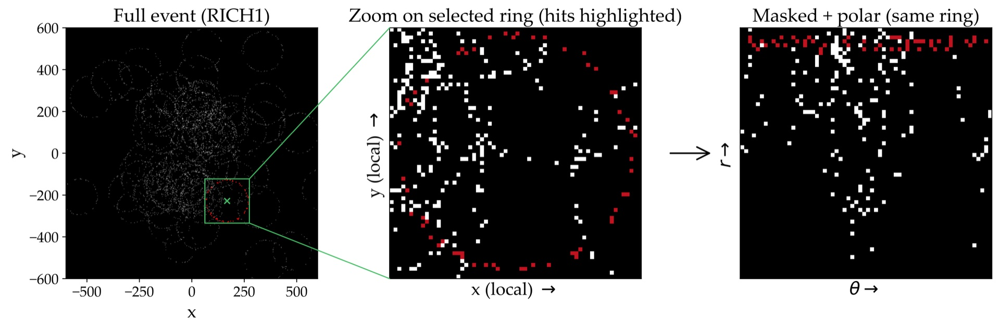

# RICH Rings Reconstruction with AI shown at EuCAIFCon2025

Our AI-based algorithm for reconstructing Cherenkov rings in RICH detectors has been presented at the 2nd European AI for Fundamental Physics Conference (EuCAIFCon2025), held in Cagliari on 16–20 June 2025.
<!--more-->

Cherenkov rings are key to identifying charged particles in high-energy physics experiments. Most ring reconstruction algorithms rely on a likelihood fit to the photo-detector response, which takes a significant fraction of the computing budget for event reconstruction: in the LHCb high-level trigger (HLT2), RICH particle identification uses about 20–40% of the CPU budget.

Our approach is based on YOLO (You Only Look Once), a state-of-the-art, open-source computer vision algorithm for real-time object detection, segmentation, and classification, which identifies objects with a single pass through a neural network.
Each ring is cut out of the full RICH1 event, masked, and transformed to polar coordinates before being classified:

{:loading="lazy" width="1920" height="635"}

From full RICH1 event (left) to a single ring (middle) and its masked polar view (right).
{:.figcaption}

We obtain a reconstruction efficiency above 95% and a pion misidentification rate below 5% across a wide momentum range for all particle species.

The details are in the conference proceedings: M. Borsato, G. Laganà, M. Martinelli, *Rings of Light, Speed of AI: YOLO for Cherenkov Reconstruction*, [arXiv:2509.26273](https://arxiv.org/abs/2509.26273).
