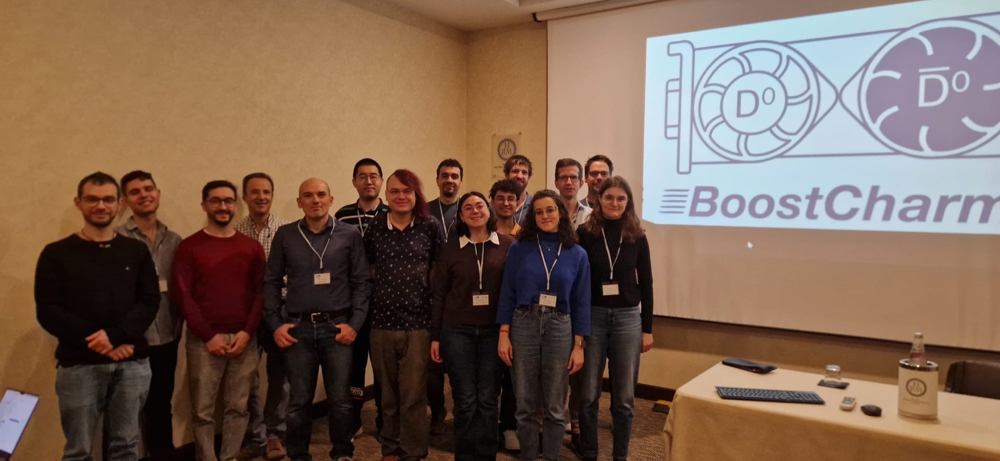

# BoostCharm: Accelerating $$ D^0 \to K^0_S \pi^+\pi^- $$

On 16–17 November 2026 we held the [BoostCharm workshop](https://indico.cern.ch/event/1734907/) in Cagliari, bringing together theorists and experimentalists to assess the current status of charm mixing and CP violation studies with $$ D^0 \to K^0_S \pi^+\pi^- $$ decays, and to discuss the prospects of the BoostCharm project in this area.
<!--more-->

{:loading="lazy" width="1920" height="887"}

The participants of the BoostCharm workshop at the Hotel Regina Margherita, Cagliari.
{:.figcaption}

The BoostCharm project aims at an innovative determination of the phase-space and decay-time acceptance of $$ D^0 \to K^0_S \pi^+\pi^- $$ decays by:

1. wisely choosing the selection requirements;
2. comparing data and simulation using control channels;
3. using AI/ML to infer the correction in the multidimensional phase space.

## Programme

The two days covered the whole chain, from theory to the experimental challenges:

* **Introduction and landscape** --- theory of charm mixing and indirect CP violation (L. Silvestrini), the current landscape of searches for CP violation in mixing (F. Betti), the experimental status of $$ D^0 \to K^0_S \pi^+\pi^- $$ (S. Stahl), and prospects at future experiments, LHCb Upgrade II and FCC (N. Jurik).
* **Bin-flip analysis** --- efficiency determination and its challenges (A. Anelli), improved Dalitz-plot binning for mixing sensitivity (M. Bovill), and strong-phase measurements at BESIII and STCF (S. Zhang).
* **Systematic uncertainties** --- reconstruction asymmetries in LHCb (P. Herrero Gascon) and $$ K^0 $$ regeneration (I. Celestino).
* **Amplitude analysis** --- amplitude modelling of $$ D^0 \to K^0_S \pi^+\pi^- $$ (L. Falcao Ferreira), the $$ \pi^+\pi^- $$ S-wave (F. Cesario Laterza Lopes), computational challenges of fitting more than 10 million decays (J. Dalseno), and model-dependent determination of mixing and CP violation in multi-body decays (F. Reiss).
* **Interplay with other measurements** --- charm mixing and the CKM angle $$ \gamma $$ (T. Pajero).

Each session closed with an open discussion, and the conclusion was unanimous: workshops like this one are enlightening and enriching for everybody, and we should organise them more often.

Many thanks to all the speakers and participants, and to my fellow organisers Andrea Contu, Alessia Anelli and Lucas Falcao Ferreira.
Slides for all the talks are available on the [Indico page](https://indico.cern.ch/event/1734907/timetable/).

The BoostCharm project is funded by the Ministero dell'Università e della Ricerca through the PRIN grant 2022LA35SY.
